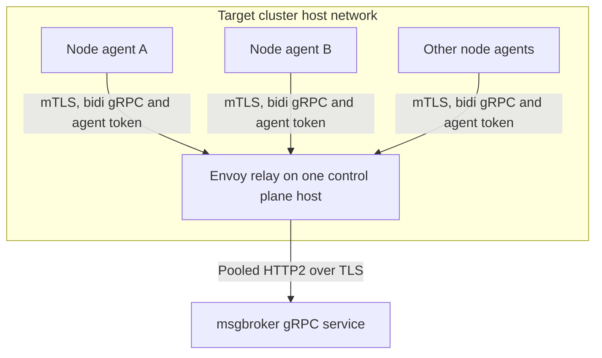
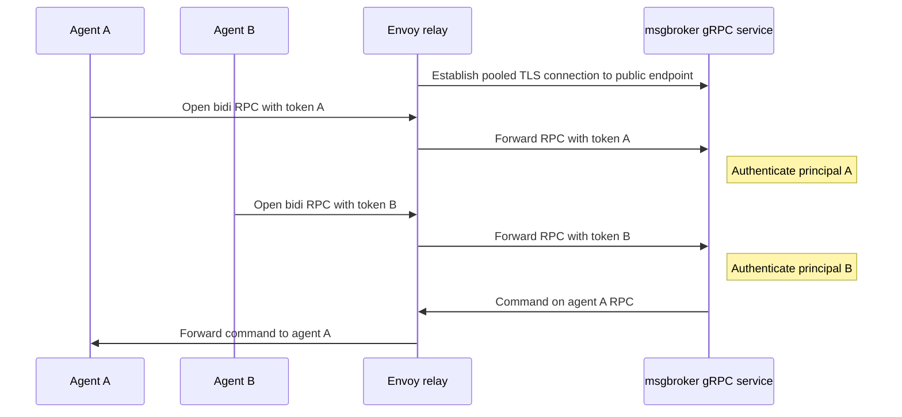

# Reduce msgbroker TCP connections with a host Envoy relay

Draft for review · October 28 2026 · Reference configuration uses the Envoy v3 API

Deploy one Envoy relay as a systemd service on a control plane host in each target cluster. All node agents connect to that relay and keep their existing long lived bidirectional gRPC calls. Envoy forwards those independent calls over a small pool of upstream HTTP/2 connections to the msgbroker gRPC service.

msgbroker runs in the management Kubernetes cluster and is accessed through its existing public endpoint. This proposal treats it as one logical service; its internal deployment and exposure are abstracted behind that endpoint.

**Decision requested** — approve a pilot after the baseline measurements and endpoint compatibility checks below establish which limit this relay addresses. The pilot must measure TCP reduction and validate stream survival, per agent authentication, and bounded recovery from silent network failures. The configuration below is an engineering example, not a production validated deployment.

## 1 Purpose and boundaries

Today each node agent opens an outbound connection to msgbroker and maintains a bidirectional streaming RPC. As node counts grow, msgbroker and its network path must hold an increasing number of TCP sockets. This proposal reduces that socket count at msgbroker while preserving the existing RPC messages and one independently authenticated stream per agent.

The relay must operate when Kubernetes scheduling, the API server, or the pod network is unavailable. It therefore runs directly on the host, with configuration and certificates on the host filesystem and host network connectivity. Host power loss, OS failure, or loss of host networking remains an outage for that relay.

| Resource | Effect of this proposal |
| --- | --- |
| TCP connections into the public msgbroker endpoint | Reduced through relay upstream HTTP/2 pooling. Backend socket counts depend separately on any service side proxying. |
| msgbroker RPC streams and agent state | Remain proportional to the number of agents. |
| Connections from agents | Still one or more per agent, now terminating at the local relay. |
| Protocol | No custom message multiplexing or protobuf redesign. |
| Failure domain | One upstream connection failure can interrupt multiple agents. |

Assumptions to confirm: agents can reach control plane host addresses, those hosts can reach msgbroker without CNI, each agent has a client certificate for mutual TLS to the relay, and per call tokens can identify agents to msgbroker. Agent to relay mTLS is a requirement. The baseline uses it as the relay admission control and keeps per call tokens as the agent identity at msgbroker. Forwarding the verified certificate identity in place of tokens is a documented alternative in section 3, with a different trust model.

### Baseline measurements required before the pilot

Connection count alone does not establish a capacity problem. Record the fleet totals and identify the first limiting resource before introducing the relay. For example, 1000 mostly idle connections on one server may be affordable, while the aggregate across many target clusters may exceed a shared limit. All values below are currently unknown and must be measured rather than inferred from the sizing examples.

| Measurement | Current value | Purpose |
| --- | --- | --- |
| Target clusters, total agents and peak concurrent RPCs | To measure | Establish fleet scale and growth. |
| Accepted sockets at the public endpoint and each internal backend boundary | To measure | Locate the actual bottleneck and existing pooling. |
| Configured or contractual connection limit and current utilization | To measure | Quantify remaining headroom. |
| File descriptors, CPU and memory per connection and per RPC | To measure | Distinguish socket cost from stream or application state cost. |
| Stream caps, idle limits, duration limits and drain policies of the real HTTP/2 peer | To verify | Establish effective capacity and maintenance behavior. |
| Agent authentication today and credential renewal dependencies | To verify | Estimate migration cost and outage exposure. |

The public endpoint may already multiplex backend connections. If so, this relay primarily reduces its front end sockets; it may not reduce msgbroker pod sockets further. Compare the relay with raising a measured limit or tuning grpc-go buffers and windows, then choose based on the limiting resource and measured savings. Buffer or window tuning must preserve acceptable throughput and memory behavior.

## 2 Architecture



*Figure 1. All node agents connect to one Envoy relay per target cluster. msgbroker is represented by one logical service box. Arrows show connection initiation; traffic within each RPC is bidirectional.*

Each agent stores the relay hostname locally and maintains one active logical session through it. If its call fails, the agent reopens the call through the same relay with backoff and jitter. Envoy handles its own upstream connections to msgbroker.

The HTTP connection manager terminates downstream HTTP/2 and TLS. The router places each RPC into an upstream HTTP/2 pool. Each upstream TCP connection can carry calls from different downstream agents. A plain TCP proxy or TLS passthrough cannot provide this pooling. [[1]](https://www.envoyproxy.io/docs/envoy/latest/intro/arch_overview/upstream/connection_pooling)

### msgbroker service boundary

Envoy connects only to the public msgbroker hostname, illustrated as `msgbroker.grpc.example.com:443`. It does not discover management Pod IPs or Kubernetes objects. The service endpoint must support native gRPC over HTTP/2, preserve per call authorization metadata, and allow long lived bidirectional streams.

msgbroker keeps one independently authenticated RPC session per agent. Pooling reduces TCP connections into its public endpoint; the application stream count remains unchanged. An established call stays with its selected msgbroker instance, and existing application session routing remains responsible for directing commands to that call.

The existing management network path must preserve HTTP/2 and suitable streaming timeouts. Any TLS termination or proxying behind the public endpoint is an implementation detail, but its connection pooling must be checked separately if application pod socket count is the bottleneck.

### Relay availability

This design deliberately uses one relay per target cluster. It introduces a shared failure point: a process crash, host reboot or relay upgrade can interrupt every agent in that cluster. Recovery starts only after the relay becomes reachable again. Keep this availability tradeoff explicit in pilot approval; host fault tolerance is outside this single relay baseline.

## 3 Authentication and authorization



*Figure 2. Each agent authenticates to the relay with its client certificate, then supplies its own token on each RPC. Envoy preserves that token on the corresponding RPC while sharing upstream TCP connections. Internal msgbroker networking is abstracted.*

Agents connect to Envoy with mutual TLS. Envoy requires a client certificate, verifies it against the agent CA, and accepts only identities issued for its own target cluster; connections without a valid certificate are rejected during the handshake, before any RPC reaches msgbroker. Envoy uses TLS with server verification to the public msgbroker endpoint. The example also presents a relay client certificate for deployments that require mTLS at that endpoint. Each agent supplies its own bearer token in initial gRPC metadata, and msgbroker verifies that token for every streaming RPC. Sharing a TCP connection does not merge RPC metadata. [[5]](https://grpc.io/docs/guides/auth/)

| Identity | Verified by | Purpose |
| --- | --- | --- |
| Relay server certificate | Agent | Authenticate the relay hostname and protect agent credentials in transit. |
| Agent client certificate | Envoy relay | Admit only agents of this target cluster to the relay. Required on every agent connection. |
| Public msgbroker endpoint certificate | Envoy | Authenticate the upstream service hostname. |
| Relay client certificate when mTLS is enabled | Public endpoint TLS termination point | Authorize relay access to the endpoint. |
| Agent token | msgbroker stream interceptor | Establish node and cluster identity independently for each RPC. |

Validate token signature, allowed signing algorithm, issuer, audience, expiry, and node and cluster claims. Derive identity from verified claims, not a caller supplied node ID. Match any node or cluster fields in application messages to that principal. Never use the shared upstream TLS peer or source IP as the agent identity.

Initial metadata is sent once. For the pilot, cap each stream at token expiry and make agents refresh and reopen before expiry with randomized timing. Returning an authentication error requires active application enforcement: a handler must stop sends, unblock receives, and return. Merely changing an interceptor context or checking expiry only at startup is insufficient. Add a revocation mechanism if policy requires immediate session termination. Token bootstrap and refresh must work without the target Kubernetes API. Document the issuer location, renewal path, retry budget and intended outage duration. If the issuer becomes unreachable, existing streams end at their enforced token expiry; there is no implicit expiry bypass. Choose token lifetime and refresh margin against this availability requirement.

The host Envoy and any service side TLS termination points can see bearer tokens and payloads and must be trusted. Do not log authorization metadata. Do not place CA signing keys on relay hosts. Store relay private keys with restrictive permissions. The baseline delegates agent token validation to msgbroker, while agent mTLS keeps clients without a valid cluster certificate from opening streams through the relay. Still restrict the listener to cluster host networks. A JWT filter at the relay can additionally reject invalid tokens earlier.

### Agent certificate requirements

Issue each agent a unique certificate whose SAN identifies its target cluster and node, for example `spiffe://example.com/cluster/<cluster>/node/<node>`. The relay matches the cluster portion of the SAN, so a certificate issued for another cluster is rejected even though it chains to the same CA. Without a SAN matcher, any certificate from the agent CA would be accepted.

Certificates are checked only during the TLS handshake. An established connection continues after the certificate that opened it expires, and neither Envoy nor msgbroker rechecks it. Agents must therefore close and redial before certificate expiry, with randomized timing, in the same way streams are capped at token expiry. Agent certificate issuance and renewal must work without the target Kubernetes API; document the issuer, renewal path and the outage duration certificate lifetime must cover. If revocation before expiry is required, add a CRL to the agent validation secret and plan its distribution to relay hosts.

To bind the two credentials, the relay can optionally forward the verified certificate identity and msgbroker can require it to match the token's node and cluster claims. This requires the XFCC forwarding described below and a msgbroker path on which the forwarded header is trustworthy; it is not part of the baseline.

### Alternative: certificate identity in place of tokens

Because agent mTLS already terminates at Envoy, the verified certificate identity could be forwarded in RPC metadata and used instead of tokens, for example through a carefully configured XFCC policy. This changes the trust model: msgbroker trusts the relay or an authenticated chain of proxies to assert the agent identity. It is not end to end proof of possession at msgbroker.

This alternative requires replacing untrusted incoming identity headers, binding identities to the authorized cluster, and protecting identity forwarding across every TLS termination point. With the existing management network path, msgbroker may see a proxy certificate rather than the relay certificate. Do not enable forwarded identity trust based only on a caller supplied header. The baseline YAML strips XFCC and implements tokens; adopting certificate forwarding requires a separate reviewed change. That change sets `forward_client_cert_details: SANITIZE_SET` with `set_current_client_cert_details: {uri: true}` on the connection manager and removes `x-forwarded-client-cert` from the route's `request_headers_to_remove`, which would otherwise strip the header Envoy sets. `SANITIZE_SET` already replaces any client supplied XFCC header. [Envoy XFCC documentation](https://www.envoyproxy.io/docs/envoy/latest/configuration/http/http_conn_man/headers#x-forwarded-client-cert).

### Agent Go integration

```go
// Illustrative fragment: relayRoots, certStore, fetchToken and the generated
// msgbroker client come from your application.
// The relay hostname must be covered by its server certificate.

// agentToken attaches a fresh bearer token when each RPC, including each
// stream, is opened.
type agentToken struct{ src func(context.Context) (string, error) }

func (t agentToken) GetRequestMetadata(ctx context.Context, _ ...string) (map[string]string, error) {
    tok, err := t.src(ctx)
    if err != nil {
        return nil, err
    }
    return map[string]string{"authorization": "Bearer " + tok}, nil
}

func (agentToken) RequireTransportSecurity() bool { return true }

tlsCfg := &tls.Config{
    RootCAs:    relayRoots,
    MinVersion: tls.VersionTLS12,
    // Read the current certificate at each handshake so a renewed
    // certificate on disk is used for new connections without a restart.
    GetClientCertificate: func(*tls.CertificateRequestInfo) (*tls.Certificate, error) {
        return certStore.Current()
    },
}

conn, err := grpc.NewClient(
    "dns:///relay.cluster.example.com:8443",
    grpc.WithTransportCredentials(credentials.NewTLS(tlsCfg)),
    grpc.WithPerRPCCredentials(agentToken{src: fetchToken}),
)
if err != nil { return err }
defer conn.Close()

stream, err := msgbrokerClient.Connect(parentCtx)
// Handle Send/Recv errors and context cancellation, then reopen the RPC.
// gRPC transport reconnection does not resume this established RPC.
// Close and redial before the client certificate expires; an established
// connection is not reauthenticated.
```

This fragment omits construction of the generated msgbroker client, certificate and token acquisition, and the reconnect loop. Construct that client using conn and keep a reusable ClientConn to the relay; do not create a new channel for every message. Coordinate Send and Recv errors so only one reconnect loop owns each logical agent session.

### msgbroker Go integration

```go
// Illustrative integration fragment. Supply your TLS and auth implementations.
srv := grpc.NewServer(
    grpc.Creds(credentials.NewTLS(serverTLSConfig)),
    grpc.MaxConcurrentStreams(1024),
    grpc.StreamInterceptor(authenticateAgentStream),
)
// serverTLSConfig follows the existing msgbroker backend transport policy.
// authenticateAgentStream must:
// 1. Authorize the immediate TLS peer according to the existing transport policy.
// 2. Read exactly one Bearer token from incoming metadata.
// 3. Validate signature, issuer, audience, expiry, cluster and node claims.
// 4. Attach the verified agent principal to the stream context.
// 5. Enforce token expiry/revocation throughout the stream lifetime.
// Handlers must bind requested node/cluster IDs to that principal.
```

Agent identity comes from the token, not the TLS peer or source IP. If the public endpoint terminates TLS before forwarding to msgbroker, the application sees its immediate backend peer rather than the relay certificate. Keep existing backend transport authentication, and verify the original agent token independently.

## 4 Connection capacity

Pool count is not a global constant. Envoy workers maintain independent pools; selected backend hosts, TLS options, priorities, and effective stream limits affect connection use. Avoid varying upstream SNI, certificates, or routing clusters by agent if the goal is shared pools. [[1]](https://www.envoyproxy.io/docs/envoy/latest/intro/arch_overview/upstream/connection_pooling)

### DNS choice and effective stream capacity

The example uses `LOGICAL_DNS` because msgbroker is accessed as one logical public service behind a load balancer. DNS refresh affects addresses used for new connections without draining existing connections solely because the answer changes. This avoids a pool per returned address and DNS induced pool churn. It does not deliberately distribute traffic across all returned addresses, and a small pool can concentrate traffic on a subset of load balancer backends. Use `STRICT_DNS` instead when explicit distribution over stable resolved addresses is required, accepting additional pools and host removal draining. [Envoy service discovery](https://www.envoyproxy.io/docs/envoy/latest/intro/arch_overview/upstream/service_discovery).

For the single relay, two workers and one logical upstream host, let `S[w]` be active RPCs assigned to worker w and let `H` be the negotiated per connection stream limit:

```text
Csteady ≈ Σ[w where S[w] > 0] ceil(S[w] / H)
H = min(Envoy upstream stream cap, public endpoint advertised stream cap)
```

This estimates busy connections, not an exact upper bound. Idle, connecting, draining and extra pools add overhead. Additional priorities or transport options can create more pools. The configured stream cap cannot override a lower peer advertised limit. [[3]](https://www.envoyproxy.io/docs/envoy/latest/api-v3/config/core/v3/protocol.proto)

| Illustrative case with 1000 agents and balanced workers | Direct connections | Pooled connections |
| --- | --- | --- |
| One relay, two workers, H = 1024 | About 1000 | About 2 |
| One relay, two workers, H = 128 | About 1000 | About 8 |
| One relay, two workers, H = 100 | About 1000 | About 10 |
| Active msgbroker RPC streams in each case | 1000 | Still 1000 |

Values of 100, 128 and 1024 are examples, not claims about your endpoint. Confirm its actual SETTINGS, request count limits, idle and maximum duration policies, and graceful drain behavior before the pilot. GOAWAY can drain a connection while established streams continue; it does not inherently terminate every existing RPC. A later forced close or duration limit may do so.

**Measurement boundary.** Relay pooling reduces TCP connections into the public msgbroker endpoint. If service side proxies terminate and recreate connections, measure their backend sockets separately. A reduction at the public endpoint does not automatically imply the same reduction at application pods.

All figures are sizing examples, not measured results. Configure a modest worker count explicitly; defaulting to every CPU on a large control plane host can create unnecessary pools. Begin with two workers, then tune against CPU and throughput. Use a small pool rather than forcing exactly one connection, to allow upstream reconnection, draining, and stream overflow.

The example sets 1024 streams per upstream connection, 8192 active requests across the cluster circuit breaker, 2048 pending requests, and a 64 connection safety ceiling. A long lived RPC counts as an active request for its entire lifetime. These values assume up to 1000 agents per target cluster and are starting values to benchmark. Circuit breakers are not desired pool sizes or a hard universal connection budget; Envoy has implementation allowances around worker pools and concurrency.

Budget relay file descriptors for all downstream sockets plus upstream sockets and headroom. Budget msgbroker memory for every active RPC. Pooling shares TCP congestion and connection flow control, so load test large messages and slow consumers alongside control traffic. Keep bulk transfers separate if they delay heartbeats or commands.

## 5 Envoy configuration

The example uses static host configuration and the v3 API. Pin an approved Envoy release and validate against that exact binary before rollout. The upstream configuration explicitly selects HTTP/2; it does not silently fall back to HTTP/1.1. [[2]](https://www.envoyproxy.io/docs/envoy/latest/api-v3/extensions/upstreams/http/v3/http_protocol_options.proto)

| Replace before use | Required value |
| --- | --- |
| `msgbroker.grpc.example.com` | Actual public msgbroker hostname; match service routing, TLS SNI and certificate DNS SAN. |
| `/msgbroker.MsgBroker/Connect` | Illustrative RPC path only. Replace it with the actual protobuf package, service, and method for msgbroker. Add explicit routes for required auxiliary RPCs. |
| `relay-server.crt/key` | Relay server certificate and key in `/etc/envoy/tls/current/`, loaded by the filesystem SDS secret below. SAN must match the relay hostname. |
| `agent-ca.crt` | Issuer of agent client certificates in `/etc/envoy/tls/current/`, loaded through the agent validation SDS secret. |
| Agent SAN prefix | Replace `spiffe://example.com/cluster/prod-east/node/` with this target cluster's identity scheme. |
| `relay-client.crt/key` | Relay identity authorized by the public endpoint when mTLS is enabled. Remove the upstream client certificate configuration if the endpoint uses server authenticated TLS only. |
| `msgbroker-ca.crt` | Public endpoint trust bundle in `/etc/envoy/tls/current/`, loaded through the validation SDS secret. |
| `/etc/envoy/sds/*.yaml` | Host provisioned SDS resources shown in section 6. Create these and valid PEM files before starting Envoy. |
| 60 second HTTP/2 PING interval | Requires approval by the actual HTTP/2 termination peer before use. |
| 40 second `TCP_USER_TIMEOUT` | A policy choice, not only a safeguard. It also closes a socket whose peer holds a zero receive window, so it must exceed the longest backpressure or congestion stall considered healthy. Accept the value only after the zero window and congestion tests in section 9. |
| 2000 downstream connection cap | Set with headroom above the maximum agent count for the target cluster. |
| IPv4 DNS policy | Change if the deployment requires IPv6 or dual stack. |

The relay YAML connects only to the public msgbroker hostname on port 443. Its upstream stream cap applies to that endpoint. Internal service deployment and exposure are outside this configuration.

Authorization metadata is preserved; the configuration does not overwrite it or add per agent transport options. The sample removes example identity and retry headers; adapt this list to your protocol. Server authentication must remain authoritative even if a client forges other metadata.

```yaml
# Envoy v3 API example. Replace example domains, RPC path, and PEM files.
# Start with: envoy -c /etc/envoy/envoy.yaml --concurrency 2
# Illustrative heap thresholds; benchmark RSS and cgroup usage separately.
overload_manager:
  refresh_interval: 0.25s
  resource_monitors:
  - name: envoy.resource_monitors.fixed_heap
    typed_config:
      "@type": type.googleapis.com/envoy.extensions.resource_monitors.fixed_heap.v3.FixedHeapConfig
      max_heap_size_bytes: 268435456
  # Hard cap on relay downstream connections; headroom above the agent count.
  - name: envoy.resource_monitors.global_downstream_max_connections
    typed_config:
      "@type": type.googleapis.com/envoy.extensions.resource_monitors.downstream_connections.v3.DownstreamConnectionsConfig
      max_active_downstream_connections: 2000
  actions:
  - name: envoy.overload_actions.stop_accepting_requests
    triggers:
    - name: envoy.resource_monitors.fixed_heap
      threshold: {value: 0.90}
  - name: envoy.overload_actions.stop_accepting_connections
    triggers:
    - name: envoy.resource_monitors.fixed_heap
      threshold: {value: 0.95}

admin:
  address:
    socket_address: {address: 127.0.0.1, port_value: 9901}

static_resources:
  listeners:
  - name: node_agents
    address:
      socket_address: {address: 0.0.0.0, port_value: 8443}
    per_connection_buffer_limit_bytes: 1048576
    filter_chains:
    - transport_socket:
        name: envoy.transport_sockets.tls
        typed_config:
          "@type": type.googleapis.com/envoy.extensions.transport_sockets.tls.v3.DownstreamTlsContext
          # Agent to relay mTLS is required.
          require_client_certificate: true
          common_tls_context:
            tls_params: {tls_minimum_protocol_version: TLSv1_2}
            alpn_protocols: [h2]
            tls_certificate_sds_secret_configs:
            - name: relay-server
              sds_config:
                resource_api_version: V3
                path_config_source:
                  path: /etc/envoy/sds/relay-server.yaml
            validation_context_sds_secret_config:
              name: agent-validation
              sds_config:
                resource_api_version: V3
                path_config_source:
                  path: /etc/envoy/sds/agent-validation.yaml
      filters:
      - name: envoy.filters.network.http_connection_manager
        typed_config:
          "@type": type.googleapis.com/envoy.extensions.filters.network.http_connection_manager.v3.HttpConnectionManager
          stat_prefix: agent_relay
          codec_type: HTTP2
          use_remote_address: true
          common_http_protocol_options:
            idle_timeout: 0s
          http2_protocol_options:
            max_concurrent_streams: 32
          # Allow silent, long-lived streams; application heartbeats detect failure.
          stream_idle_timeout: 0s
          stream_flush_timeout: 30s
          request_timeout: 0s
          request_headers_timeout: 10s
          route_config:
            name: agent_routes
            virtual_hosts:
            - name: agents
              domains: ["*"]
              request_headers_to_remove:
              - x-agent-id
              - x-cluster-id
              - x-forwarded-client-cert
              - x-envoy-retry-on
              - x-envoy-retry-grpc-on
              - x-envoy-max-retries
              - x-envoy-upstream-rq-timeout-ms
              - x-envoy-upstream-rq-per-try-timeout-ms
              routes:
              - match:
                  path: /msgbroker.MsgBroker/Connect
                  grpc: {}
                route:
                  cluster: msgbroker
                  host_rewrite_literal: msgbroker.grpc.example.com
                  timeout: 0s
                  idle_timeout: 0s
              # Do not create an unrestricted forward proxy.
              - match: {prefix: /}
                direct_response: {status: 404}
          http_filters:
          - name: envoy.filters.http.router
            typed_config:
              "@type": type.googleapis.com/envoy.extensions.filters.http.router.v3.Router
          access_log:
          - name: envoy.access_loggers.stdout
            typed_config:
              "@type": type.googleapis.com/envoy.extensions.access_loggers.stream.v3.StdoutAccessLog
              log_format:
                text_format_source:
                  inline_string: '%START_TIME% %REQ(:PATH)% %PROTOCOL% %RESPONSE_CODE% %GRPC_STATUS% %RESPONSE_FLAGS% %DURATION%ms\n'

  clusters:
  - name: msgbroker
    type: LOGICAL_DNS
    connect_timeout: 10s
    upstream_connection_options:
      tcp_keepalive:
        keepalive_time: 60
        keepalive_interval: 10
        keepalive_probes: 3
    # Close an upstream socket whose sent data stays unacknowledged for 40 s.
    # Linux only. The current API accepts socket_options without source_address;
    # verify the option on a live upstream socket of the pinned build.
    upstream_bind_config:
      socket_options:
      - level: 6            # IPPROTO_TCP
        name: 18            # TCP_USER_TIMEOUT
        int_value: 40000    # milliseconds
        state: STATE_PREBIND
    lb_policy: ROUND_ROBIN
    dns_lookup_family: V4_ONLY
    per_connection_buffer_limit_bytes: 1048576
    load_assignment:
      cluster_name: msgbroker
      endpoints:
      - lb_endpoints:
        - endpoint:
            address:
              socket_address:
                address: msgbroker.grpc.example.com
                port_value: 443
    typed_extension_protocol_options:
      envoy.extensions.upstreams.http.v3.HttpProtocolOptions:
        "@type": type.googleapis.com/envoy.extensions.upstreams.http.v3.HttpProtocolOptions
        common_http_protocol_options:
          idle_timeout: 0s
        explicit_http_config:
          http2_protocol_options:
            max_concurrent_streams: 1024
            # Require the actual endpoint to permit this PING policy.
            connection_keepalive:
              interval: 60s
              timeout: 10s
              interval_jitter: {value: 15}
    # Illustrative capacity for <=1000 agents on the single relay.
    # These are safety ceilings, not desired pool sizes.
    circuit_breakers:
      thresholds:
      - priority: DEFAULT
        max_connections: 64
        max_pending_requests: 2048
        max_requests: 8192
        max_retries: 0
    transport_socket:
      name: envoy.transport_sockets.tls
      typed_config:
        "@type": type.googleapis.com/envoy.extensions.transport_sockets.tls.v3.UpstreamTlsContext
        sni: msgbroker.grpc.example.com
        common_tls_context:
          tls_params: {tls_minimum_protocol_version: TLSv1_2}
          alpn_protocols: [h2]
          tls_certificate_sds_secret_configs:
          - name: relay-client
            sds_config:
              resource_api_version: V3
              path_config_source:
                path: /etc/envoy/sds/relay-client.yaml
          validation_context_sds_secret_config:
            name: msgbroker-validation
            sds_config:
              resource_api_version: V3
              path_config_source:
                path: /etc/envoy/sds/msgbroker-validation.yaml
```

### Why these settings matter

| Setting | Reason |
| --- | --- |
| HTTP connection manager and router | Operate at HTTP/2 stream level and share upstream pools across downstream connections. |
| Explicit upstream HTTP/2 and h2 ALPN | Preserve native gRPC transport on the msgbroker connection. |
| Route `timeout: 0s` and `idle_timeout: 0s` | Avoid route timeouts terminating a healthy long lived RPC, including after a client half close. |
| HCM `stream_idle_timeout: 0s` and `request_timeout: 0s` | Permit silent streams and requests that intentionally never finish. Application heartbeats supply liveness. |
| `stream_flush_timeout: 30s` | Bound a stuck final flush after end of stream without imposing a lifetime on active streams. |
| `request_headers_timeout: 10s` | Bound incomplete initial headers. |
| Connection `idle_timeout: 0s` | Avoid closing idle pool connections. This is distinct from stream idle timeouts. |
| Upstream HTTP/2 keepalive | Close an unresponsive pooled transport rather than continually assigning replacement calls to it. Does not measure application health. |
| Upstream TCP keepalive | Socket level backstop for idle sockets; it does not probe while sent data is unacknowledged. |
| Upstream `TCP_USER_TIMEOUT` | Close a pooled socket whose sent data stays unacknowledged, covering a one direction blackhole that HTTP/2 PING may not detect. Sustained zero window backpressure triggers it too, disconnecting every agent on that connection. |
| `require_client_certificate` with agent SAN matcher | Enforce agent mTLS and reject certificates issued for other clusters during the handshake. |
| Filesystem SDS | Reload certificates and trust context without an Envoy process restart. |
| Heap overload actions | Reject new requests and stop accepting connections before the illustrative heap budget is exhausted. |
| Global downstream connection cap | Hard limit on agent connections held by the relay, independent of heap pressure, to bound reconnect storms. |
| Per connection buffer watermarks | Apply backpressure; these are soft limits, not a total process memory cap. |
| No retry policy and `max_retries: 0` | Keep stream reconstruction and message recovery under application control. |
| Local admin on 127.0.0.1 | Keep the privileged admin endpoint off the cluster network. |

Route, request, and stream idle timers have different meanings; setting only one to zero is insufficient. [[4]](https://www.envoyproxy.io/docs/envoy/latest/api-v3/extensions/filters/network/http_connection_manager/v3/http_connection_manager.proto) Retain existing finite agent deadlines only if intentional: Envoy cannot extend a client deadline. Do not add buffering filters that wait for the entire request body.

### Flow control and memory tuning

Before the pilot, record the pinned build's effective stream and connection receive windows on both legs. Benchmark its defaults against a candidate of 65536 bytes per stream and 1048576 bytes per connection. Smaller windows can reduce in flight data but also constrain throughput on high latency links; do not assume they are universally better. The example does not override these windows. Choose final values using representative messages, slow readers and the actual bandwidth delay product.

The sample overload manager uses a 256 MiB heap budget with thresholds below that budget. These are illustrative safeguards. These thresholds aim to trigger overload actions before cgroup throttling at `MemoryHigh=400M`, with the `MemoryMax=512M` kill last; confirm that ordering under representative load. Non-heap memory and socket buffers can grow independently of the heap, so the comparison with the heap budget does not guarantee the order. Do not set `MemoryHigh` at or near the heap budget: total memory includes TLS state, socket buffers and allocator overhead, so the cgroup would cross its soft limit before the overload manager acts. Above `MemoryHigh` the kernel throttles the process while trying to reclaim memory it largely cannot reclaim, which stalls every agent instead of cleanly rejecting new calls. Heap is not total RSS or cgroup memory; leave measured headroom for other allocations and socket buffers. Rejecting new calls cannot prevent memory growth from existing streams. Monitor all three signals, bound application queues, and consider a cgroup memory monitor if supported by the pinned build. [Envoy overload manager](https://www.envoyproxy.io/docs/envoy/latest/configuration/operations/overload_manager/overload_manager).

## 6 Host deployment and operation

Install a pinned Envoy binary, the systemd unit, certificates, trust bundles, and endpoint configuration as part of host provisioning. Do not require a Kubernetes Secret mount, Kubernetes DNS, kubelet, a static pod, or a live xDS service inside the target cluster. Ensure host routes, DNS resolution, outbound firewall rules, and time synchronization survive the intended Kubernetes outage.

This placement assumes self managed clusters with an accessible control plane host. For managed Kubernetes whose control plane hosts are inaccessible, place the host service on a suitable accessible node or dedicated VM with node network reachability and independent lifecycle; confirm outage behavior there.

Agents receive the relay hostname, relay CA trust bundle, and their own client certificate and key in local configuration. The msgbroker endpoint resolves through host reachable DNS or a supported host configuration. Permit inbound TCP 8443 only from the target cluster node networks, and outbound TCP 443 to msgbroker. Keep admin TCP 9901 local. Do not expose the listener as a general internet proxy.

### Example systemd unit

Save the following as `/etc/systemd/system/agent-relay.service`.

```ini
[Unit]
Description=Host relay for node agent gRPC streams
Wants=network-online.target
After=network-online.target
StartLimitIntervalSec=0

[Service]
Type=simple
User=envoy
Group=envoy
ExecStart=/usr/local/bin/envoy -c /etc/envoy/envoy.yaml --concurrency 2
Restart=always
RestartSec=5s
LimitNOFILE=65536
CPUWeight=20
MemoryHigh=400M
MemoryMax=512M
NoNewPrivileges=true
ProtectSystem=strict
ProtectHome=true
PrivateTmp=true

[Install]
WantedBy=multi-user.target
```

Create the envoy user and read only config directories during provisioning. Place keys in group readable files owned by root and envoy, for example mode 0640. The resource values above are illustrative; benchmark peak agent demand before using them on a control plane host. CPUWeight is relative scheduling weight, not a hard CPU cap. Keep `MemoryHigh` clearly above the overload manager heap thresholds and below `MemoryMax`; adjust all three together. Raise or lower limits based on measured memory and control plane impact.

### Preflight and startup

```bash
# Run with the exact installed binary and actual certificate files.
/usr/local/bin/envoy --mode validate -c /etc/envoy/envoy.yaml
sudo systemctl daemon-reload
sudo systemctl enable --now agent-relay.service
curl -fsS http://127.0.0.1:9901/ready
curl -fsS http://127.0.0.1:9901/stats/prometheus
```

The validation command checks configuration and referenced material; it does not prove that the upstream endpoint is reachable or that agent credentials work. The admin ready endpoint reports Envoy state, not end to end msgbroker health.

### Certificates and configuration changes

The baseline uses filesystem backed SDS, not a remote xDS service or Kubernetes Secret mount. Create these four host files before startup. They supply the named secrets referenced by the main YAML. Each file is a separate SDS DiscoveryResponse; do not append these resources to the bootstrap configuration.

`/etc/envoy/sds/relay-server.yaml`:

```yaml
version_info: "1"
resources:
- "@type": type.googleapis.com/envoy.extensions.transport_sockets.tls.v3.Secret
  name: relay-server
  tls_certificate:
    certificate_chain: {filename: /etc/envoy/tls/current/relay-server.crt}
    private_key: {filename: /etc/envoy/tls/current/relay-server.key}
    watched_directory: {path: /etc/envoy/tls}
```

`/etc/envoy/sds/relay-client.yaml`:

```yaml
version_info: "1"
resources:
- "@type": type.googleapis.com/envoy.extensions.transport_sockets.tls.v3.Secret
  name: relay-client
  tls_certificate:
    certificate_chain: {filename: /etc/envoy/tls/current/relay-client.crt}
    private_key: {filename: /etc/envoy/tls/current/relay-client.key}
    watched_directory: {path: /etc/envoy/tls}
```

`/etc/envoy/sds/msgbroker-validation.yaml`:

```yaml
version_info: "1"
resources:
- "@type": type.googleapis.com/envoy.extensions.transport_sockets.tls.v3.Secret
  name: msgbroker-validation
  validation_context:
    trusted_ca: {filename: /etc/envoy/tls/current/msgbroker-ca.crt}
    match_typed_subject_alt_names:
    - san_type: DNS
      matcher: {exact: msgbroker.grpc.example.com}
    watched_directory: {path: /etc/envoy/tls}
```

`/etc/envoy/sds/agent-validation.yaml`:

```yaml
version_info: "1"
resources:
- "@type": type.googleapis.com/envoy.extensions.transport_sockets.tls.v3.Secret
  name: agent-validation
  validation_context:
    trusted_ca: {filename: /etc/envoy/tls/current/agent-ca.crt}
    # Accept only identities issued for this target cluster.
    match_typed_subject_alt_names:
    - san_type: URI
      matcher: {prefix: "spiffe://example.com/cluster/prod-east/node/"}
    watched_directory: {path: /etc/envoy/tls}
```

When rotating the agent CA, publish a bundle containing both the old and new CA before agents receive certificates from the new CA, and remove the old CA only after every agent has renewed.

Keep `/etc/envoy/tls/current` as a symlink to a complete versioned directory containing all referenced PEM files. Provision and validate the next certificate, key and trust bundle set, then atomically replace the `current` symlink in `/etc/envoy/tls` using the host renewal service. This directory move triggers reload of the referenced secrets. Updating SDS resource files themselves also requires a watched atomic replacement; increment `version_info` for explicit resource revisions. Use a tested atomic rotation method, not in place edits that may leave a mismatched certificate and key. [Envoy filesystem SDS rotation](https://www.envoyproxy.io/docs/envoy/latest/configuration/security/secret).

The renewal service and file permissions must work without the target Kubernetes API. Ensure the systemd sandbox permits Envoy to read the versioned paths; the external renewal service performs writes. Check SDS update and failure counters, new TLS handshakes, and session continuity during rotation. Avoid simultaneous trust bundle and identity changes without an overlap period. Loaded TLS contexts do not retroactively reauthenticate established sessions; verify the pinned build's upstream connection behavior on secret updates and any required revocation policy. Certificate reload avoids a process restart but is not a promise of zero connection churn.

If endpoint mTLS is not used, omit `relay-client` from the upstream TLS configuration and its SDS file. This has no effect on per agent token verification.


A restart or upgrade of the single relay interrupts all agent sessions in that target cluster. Schedule a maintenance window, use a bounded drain period, then let agents reconnect with jitter. An indefinitely lived RPC can prevent an unbounded graceful drain from completing. Test the same reconnect behavior during msgbroker maintenance.

## 7 Failure handling and stream recovery

| Event | Expected behavior | Required application behavior |
| --- | --- | --- |
| Kubernetes API or CNI outage | Host relay remains available if host network and agent processes survive. | Use host reachable addresses and locally available credentials and settings. |
| Relay process or host failure | All cluster agent streams fail until the relay is restored. | Restart the process or recover the host; agents retry the same relay with jitter and reopen calls. |
| Pooled upstream reset or silent blackhole | A reset fails affected RPCs immediately; a silent failure requires keepalive or other transport detection before the stale pool connection is discarded. | Spread reconnect attempts and verify a fresh upstream connection is established. |
| msgbroker instance failure or maintenance | Affected calls fail; new calls reconnect through the public service endpoint. | Reopen calls and replace stale stream registrations using session generations or fencing. |
| Public msgbroker endpoint unavailable | New calls cannot reach the service; existing calls may fail. | Retry with bounded backoff and jitter until service availability returns. |
| Stream or circuit breaker capacity reached | Calls may queue or fail according to pool and breaker state. | Bound reconnect rate; alert and increase verified capacity. |
| Missing, expired, untrusted or wrong cluster agent certificate | Envoy rejects the TLS handshake; no RPC reaches msgbroker. | Renew the certificate; avoid tight retries on handshake failures. |
| Expired or revoked token | msgbroker rejects or actively ends the affected RPC. | Refresh credentials; avoid tight retries on invalid credentials. |

Suggested initial reconnect policy: exponential backoff starting at one second with a 30 second cap and full jitter. Apply an establishment budget, for example 10 seconds, before backing off and retrying the same relay. Reset backoff after a stable session, not immediately after a connection briefly succeeds. Handle both Send and Recv failures. Never assume gRPC channel reconnection resumes a broken streaming call.

### Upstream liveness and silent failures

Use both transport keepalive and application heartbeats. The configured upstream HTTP/2 PING policy is 60 seconds plus up to 15 percent interval jitter, with a 10 second response timeout. If the peer stops responding completely, the intended transport detection budget is roughly 79 seconds before connection setup and agent reconnect time. This is an estimate, not a recovery guarantee: scheduling, ongoing received frames, the endpoint and application retries affect timing. Measure it under load. Envoy extends the PING timeout when frames are received, so a responsive transport with a stuck application must be detected by application heartbeats. [Envoy keepalive API](https://www.envoyproxy.io/docs/envoy/latest/api-v3/config/core/v3/protocol.proto#config-core-v3-keepalivesettings).

The actual HTTP/2 peer must permit this policy before deploying the sample. A grpc-go server defaults to a five minute minimum client PING interval. If msgbroker is the direct peer, configure its enforcement policy to allow the agreed interval, for example `keepalive.EnforcementPolicy{MinTime: 60 * time.Second, PermitWithoutStream: true}` through `grpc.KeepaliveEnforcementPolicy`. The no stream permission is needed because pool connections can remain open without active calls. If a proxy terminates HTTP/2, configure that proxy instead; changing msgbroker alone does not change the relay to proxy hop. Verify each terminated hop independently. Do not lengthen the interval to five minutes while retaining an untested 120 second transport recovery target. [grpc-go keepalive options](https://pkg.go.dev/google.golang.org/grpc/keepalive).

Start with application heartbeats every 30 seconds and a 90 second missing response threshold. Agent PINGs terminate at Envoy and upstream PINGs terminate at the public endpoint; neither proves the application is processing commands. An application heartbeat traverses the full logical service path. Reopening RPCs without transport detection can assign new streams to a still unusable pooled connection, so heartbeats alone are insufficient for the bounded recovery goal. TCP keepalive is an additional backstop, not a substitute for the HTTP/2 PING timeout.

A one direction blackhole needs a separate guard. If packets from the relay to the endpoint are lost while the endpoint keeps sending frames, for example pushed commands or server initiated PINGs, each received frame extends the HTTP/2 PING timeout and Envoy may never close the connection. TCP keepalive does not help, because it probes only idle sockets and this socket has unacknowledged outbound data. Without another guard, detection falls back to TCP retransmission limits, roughly 15 minutes with Linux defaults. The upstream `TCP_USER_TIMEOUT` of 40 seconds closes the socket when sent data stays unacknowledged that long. This timeout measures stalled TCP progress, not time since the network failure began, and it is not an application response timeout. On Linux it also applies while the peer advertises a zero receive window, so sustained backpressure from a slow but working endpoint can close a pooled connection and disconnect every agent sharing it. Treat 40 seconds as a policy choice that trades blackhole detection speed against tolerance for backpressure. Accept it only after testing a zero window peer and transient congestion with representative traffic.

Test silent packet loss in both directions without generating FIN, RST or an ICMP rejection, separately from a clean connection reset. For the relay to endpoint direction, keep the endpoint sending traffic during the test so that HTTP/2 PING alone cannot detect it, and confirm that `TCP_USER_TIMEOUT` closes the socket. Verify that Envoy discards the stale pooled connection and does not repeatedly assign replacement RPCs to it. A persistent partition cannot recover until connectivity returns; report detection time and post restoration recovery time separately. GOAWAY may gracefully drain existing RPCs, while a forced transport close interrupts them.

Each failure mode is detected by a different mechanism, so record each separately rather than holding all of them to one budget:

| Failure case | Primary detection | Expected detection | Result |
| --- | --- | --- | --- |
| TCP reset | Immediate socket error | Near immediate | To measure |
| Complete silent blackhole | Upstream HTTP/2 PING timeout | Roughly 79 seconds | To measure |
| One direction loss while inbound frames continue | `TCP_USER_TIMEOUT` on stalled outbound data | Depends on traffic pattern; not bounded by the PING estimate | To measure |
| Healthy transport, unresponsive msgbroker application | Application heartbeat threshold | About 90 seconds | To measure |

The approximately 79 second figure applies only to the complete blackhole case. Whether `TCP_USER_TIMEOUT` gives the intended bound for one direction loss must be measured with the actual traffic pattern.


Envoy does not replay messages after a broken stream. Where delivery matters, use command IDs, acknowledgments, idempotent processing, and bounded resumption state. Handle an agent reconnecting before the previous half open session is discovered: a new session generation must fence the old one. These are application concerns and may already exist in the current agent protocol.

## 8 Observability

Record separate gauges for agent to relay sockets, relay to msgbroker endpoint sockets, and active RPCs. Where msgbroker has internal proxy hops, measure their backend connections separately. Success means upstream TCP connections fall while the expected RPC count and command delivery remain healthy. Never use completion only access logs as the active session count; a long lived stream may not log until it closes.

| Signal | Use |
| --- | --- |
| `http.agent_relay.downstream_cx_active` | Agent connections held by the relay. |
| Listener `ssl.fail_verify_no_cert`, `ssl.fail_verify_san`, `ssl.fail_verify_error` | Agent mTLS rejections: missing certificates, wrong cluster identities and untrusted or expired certificates. |
| `cluster.msgbroker.upstream_cx_active` | Current relay TCP connections to the public msgbroker endpoint, not any internal service side connections. |
| `cluster.msgbroker.upstream_rq_active` | Active upstream RPC requests, including persistent streams. |
| `upstream_cx_connect_fail`, `upstream_cx_overflow`, `upstream_rq_pending_overflow` | Connectivity and circuit breaker pressure under the msgbroker cluster stats prefix. |
| `upstream_cx_destroy_with_active_rq` | Connection losses that may disconnect many agents. |
| msgbroker authenticated sessions, heartbeats and reconnects | Actual node reachability and restoration time. |
| Relay RSS, heap, cgroup memory, CPU, open FDs and network throughput | Resource safety on relay hosts. Alert if cgroup memory approaches `MemoryHigh` before overload actions activate. |
| Global downstream connection overflow | Connections rejected by the relay connection cap during reconnect surges. |
| HTTP/2 keepalive timeouts, ping related GOAWAY and recovery latency | Detect silent transport failures and policy mismatches. |
| SDS context updates, rejected updates and new handshake failures | Confirm certificate rotation and reject invalid resources. |
| Overload action state and rejected calls | Establish overload protection and capacity headroom. |

Metric names above use Envoy’s native stats naming; Prometheus export normalizes names and labels. Check the pinned version’s actual output. [[7]](https://www.envoyproxy.io/docs/envoy/latest/configuration/upstream/cluster_manager/cluster_stats) Track the ratio of active RPCs to upstream TCP connections, command latency, authentication failures, token renewal errors, and time to restore the last agent after an interruption. Avoid unbounded per node metric labels.

## 9 Pilot validation and rollout

Do not begin rollout until the baseline table identifies the limiting resource and the endpoint owner confirms the keepalive policy, effective stream cap, streaming timeouts and DNS behavior.

**Proposed pilot acceptance criteria** — all 1000 synthetic agents can hold an independently authenticated bidirectional call; steady state TCP connections into the public msgbroker endpoint are at least ten times lower than the direct connection baseline; application pod socket counts meet a separately defined budget based on actual service side pooling; no cross agent command delivery occurs; and at least 99 percent of agents recover within 120 seconds after a pooled TCP reset while the service remains reachable, and within 120 seconds of restoring relay or network availability in outage tests. Record detection and recovery separately for the four failure cases in section 7: TCP reset, complete silent blackhole, one direction loss while inbound frames continue, and an unresponsive msgbroker application on a healthy transport. Do not hold every case to the 79 second PING estimate, and test each combined reconnect budget rather than assuming it fits. A permanent outage is not a recoverable event. Confirm these targets against product requirements before treating them as SLOs. Verify graceful certificate rotation without an Envoy process restart; record any connection churn, CPU impact, invalid update handling, and authentication failures.

1. **Validate the exact build.** Pin supported Envoy and msgbroker grpc-go versions. Run Envoy validation with actual PEM files. Verify h2 negotiation, endpoint PING acceptance, `TCP_USER_TIMEOUT` application on upstream sockets, agent mTLS enforcement, token forwarding, mTLS identities, SDS secret loading, overload extensions and SAN validation on every terminated TLS leg. Confirm TLS failures fail closed.
2. **Prove pooling.** Open concurrent bidi calls from separate client processes. Compare downstream connections, upstream connections, active RPCs, and server accepted sockets at the same time. Repeat with two workers and the actual public msgbroker endpoint. Measure internal backend sockets separately if relevant to the bottleneck.
3. **Prove isolation.** Reject connections with no client certificate, an expired or untrusted certificate, and a valid certificate issued for another target cluster. Use unique agent tokens and messages. Reject missing, expired, wrongly scoped, and forged tokens. Verify invalid token B cannot affect agent A’s stream. Test duplicate identity fields and token expiry while idle.
4. **Soak and stress.** Hold calls for at least 24 hours, including long silent periods. Test half closes, slow readers, large messages, saturation of measured stream limits, window tuning candidates, memory pressure and reconnect surges. Check control plane CPU, memory, and command latency.
5. **Inject failures.** Restart the relay; stop and restore its host network; reset one upstream TCP connection; silently blackhole it in each direction without sending a reset, including relay to endpoint loss while the endpoint continues sending, then restore the path; hold a zero receive window at the peer and induce transient congestion to confirm the `TCP_USER_TIMEOUT` value does not disconnect working connections; restart msgbroker; interrupt DNS; and make the target Kubernetes API and CNI unavailable in a test environment. Measure restoration and check duplicate execution handling.
6. **Exercise maintenance.** Rotate certificates, keys and CA bundles through filesystem SDS without restarting Envoy, including an agent CA rotation with an overlap bundle; renew agent certificates and confirm agents redial before expiry; test a rejected update and a renewal outage. Test token refresh during a target Kubernetes outage. Separately restart the relay during a maintenance window, restart msgbroker, and verify old sessions are fenced. Confirm no rollout depends on target Kubernetes resources.
7. **Expand gradually.** Start with one nonproduction target cluster, then a small production cohort. Compare socket reduction, command latency, and reconnect rates before expanding.

For rollback, restore agents’ existing direct msgbroker endpoint from host configuration and reopen streams with jitter. Preserve the direct endpoint and its authentication compatibility through the pilot. Stage rollback so msgbroker is not suddenly flooded with every direct connection at once. The relay configuration must not make that recovery path depend on Kubernetes.

## 10 Deployment decisions still required

- Completed baseline measurements, fleet scale and measured headroom at the precise msgbroker service socket bottleneck.
- Approved Envoy release, measured relay CPU and memory budget, effective endpoint stream limits, and approved per hop keepalive policy.
- Actual msgbroker protobuf RPC path, relay hostname, public msgbroker hostname, and host DNS availability during outages.
- Existing msgbroker endpoint TLS policy, any internal connection pooling constraints, and the socket budget at the actual bottleneck.
- Agent certificate issuer, SAN scheme, lifetime, renewal path during a Kubernetes outage, and CRL requirements.
- Chosen identity model at msgbroker (tokens by default, or certificate forwarding), migration cost, token issuer and renewal outage budget, token lifetime, and revocation requirements.
- Host certificate renewal owner, filesystem SDS rotation procedure, trust overlap and invalid update response.
- Accepted single relay availability tradeoff and managed cluster fallback placement if needed.
- Whether node agents themselves run as host services and remain functional during the Kubernetes failures the design must cover.
- Message acknowledgment and replay requirements, maintenance interruption budget, and recovery acceptance targets.

**Review status** — configuration parsed as YAML and reviewed against the linked upstream API documentation. Architecture diagrams use native Mermaid fenced code blocks. Both diagrams were checked with Mermaid 10.9 and 11.12 parsers, and all embedded YAML examples were parsed and checked for consistent secret and route references. An Envoy binary and live cluster were not available for runtime validation; the acceptance tests above remain required before deployment.

## References

Official sources checked October 28 2026. The latest Envoy documentation can describe development versions; validate every setting against the release you pin. Capacity values and rollout targets in this proposal are design assumptions, not upstream guarantees.

1. [Envoy connection pooling](https://www.envoyproxy.io/docs/envoy/latest/intro/arch_overview/upstream/connection_pooling)
2. [Envoy upstream HTTP protocol options](https://www.envoyproxy.io/docs/envoy/latest/api-v3/extensions/upstreams/http/v3/http_protocol_options.proto)
3. [Envoy HTTP protocol and HTTP/2 stream limits](https://www.envoyproxy.io/docs/envoy/latest/api-v3/config/core/v3/protocol.proto)
4. [Envoy connection manager and route timeout APIs](https://www.envoyproxy.io/docs/envoy/latest/api-v3/extensions/filters/network/http_connection_manager/v3/http_connection_manager.proto)
5. [gRPC authentication and call credentials](https://grpc.io/docs/guides/auth/)
6. [gRPC keepalive guidance](https://grpc.io/docs/guides/keepalive/)
7. [Envoy upstream cluster statistics](https://www.envoyproxy.io/docs/envoy/latest/configuration/upstream/cluster_manager/cluster_stats)
8. [Envoy route timeout API](https://www.envoyproxy.io/docs/envoy/latest/api-v3/config/route/v3/route_components.proto)


9. [Envoy DNS service discovery](https://www.envoyproxy.io/docs/envoy/latest/intro/arch_overview/upstream/service_discovery)
10. [Envoy filesystem SDS](https://www.envoyproxy.io/docs/envoy/latest/configuration/security/secret)
11. [Envoy overload manager](https://www.envoyproxy.io/docs/envoy/latest/configuration/operations/overload_manager/overload_manager)
12. [grpc-go keepalive options](https://pkg.go.dev/google.golang.org/grpc/keepalive)
13. [Envoy XFCC identity forwarding](https://www.envoyproxy.io/docs/envoy/latest/configuration/http/http_conn_man/headers#x-forwarded-client-cert)
