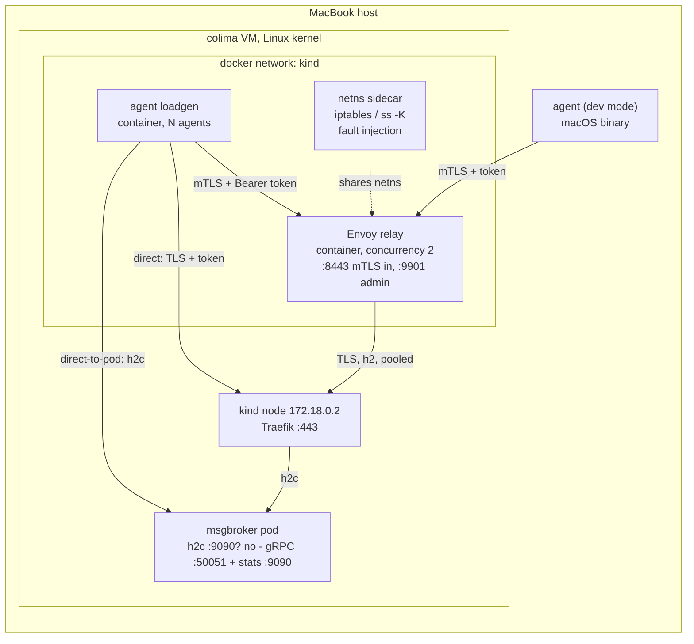

# POC plan — Envoy relay for msgbroker bidirectional gRPC

Companion to [`grpc_envoy_design_proposal.md`](grpc_envoy_design_proposal.md) · drafted 2026-10-28
Target: this MacBook, a pre-existing shared kind cluster, `*.localtest.me` hostnames

> **Execution update (2026-10-28).** The plan below was written for 200–1000 synthetic
> agents. Real target clusters run **fewer than 10 agents**, so the executed POC is
> calibrated at 5 and 10 agents (200/1000 kept as a scale ceiling only). Results and the
> revised recommendation are in [`poc_results.md`](poc_results.md). The short
> version: pooling works, but the ingress already pools to one socket, so at <10 agents
> the relay adds a hop rather than reducing sockets.
>
> **Later update.** The POC no longer assumes a pre-existing cluster: `scripts/00-cluster-up.sh`
> creates a dedicated kind cluster (`grpc-poc`) with pinned cert-manager, a CA ClusterIssuer
> and Traefik, modelled on `launchpad-template/hack/setup.sh`. It publishes host ports
> 80/443 (override HTTP_PORT/GRPC_PORT if another cluster publishes them).
> The relay runs with one Envoy worker (`ENVOY_CONCURRENCY=1`) so the upstream pool is a
> single connection; set `ENVOY_CONCURRENCY=2` to reproduce the two-worker sizing above.
> Path labels also changed after execution: the direct-to-pod probe (old P1) is no longer
> a measurement path — `p1` is direct through the ingress and `p2` is via the relay. The
> sections below keep the original three-path naming.

---

## 1. What this POC proves

The proposal claims that a host-level Envoy relay lets many node agents share a small pool of
upstream HTTP/2 connections to the msgbroker public endpoint, without changing the RPC contract,
while keeping one independently authenticated bidirectional stream per agent.

This POC reproduces that claim end to end on one laptop with synthetic agents:

| # | Claim to validate | How it is proven here |
| --- | --- | --- |
| C1 | A bidirectional gRPC service works through the cluster ingress to an external client | Go agents open long-lived bidi streams through Traefik |
| C2 | Envoy relays N downstream bidi streams over `ceil(N/H)` upstream TCP connections | Compare `downstream_cx_active` vs `cluster.msgbroker.upstream_cx_active` at N = 200 and 1000 |
| C3 | RPC metadata (per-agent bearer token, agent id) survives pooling; no cross-agent delivery | Per-agent unique commands and acks, 100 % match check |
| C4 | Agent mTLS + SAN prefix matching rejects non-cluster and untrusted clients at handshake | Negative TLS matrix in Phase 5 |
| C5 | Streams survive long silences; failures are detected and repaired in bounded time | Injected reset, blackhole, one-way loss, app hang |

### Out of scope (and must be said out loud in the results)

- Real control-plane host, systemd, host DNS during a Kubernetes outage — the relay runs as a container
  on the laptop. The proposal's §6 outage behaviour is **not** reproduced.
- Multi-cluster / multi-relay capacity planning; we run exactly one relay.
- Service-side internal proxies. In this POC the only internal hop is Traefik → msgbroker pod.
- Production token issuance and CRL distribution. We use locally signed short-lived tokens.
- macOS kernel behaviour. The relay runs on the Linux kernel inside the colima VM so `TCP_USER_TIMEOUT`
  (option 18, Linux-only) is actually exercised.

---

## 2. Environment, as verified today

Facts collected before writing this plan (colima had been stopped, now started):

| Item | Value |
| --- | --- |
| kind cluster | pre-existing shared cluster, k8s v1.29.2, single control-plane node, `ingress-ready=true` |
| Kind node image | `kindest/node:v1.29.2` (arm64), node IP `172.18.0.2` |
| Ingress controller | Traefik `v3.2.2`, namespace `traefik`, entrypoints `web:8000→host 80`, `websecure:8443→host 443` |
| Host → ingress | `http(s)://127.0.0.1` and `127.0.0.1:443` return Traefik's 404 — reachable |
| Container → ingress | `--add-host host:host-gateway` (= `192.168.5.2`) reaches Traefik; on the `kind` docker network `172.18.0.2:443` also works |
| Existing ingress style | Traefik `IngressRoute` CRDs (`traefik.io/v1alpha1`), `tls.secretName`, not core `Ingress` |
| Existing DNS convention | `*.localtest.me` (resolves to 127.0.0.1) |
| cert-manager | running; `ClusterIssuer/launchpad-ca-issuer` (Ready) signs from `launchpad-ca-tls` (root CN=launchpad-ca, valid to 2036) |
| Other workloads | `lp-e2e`, `keycloak`, many `user-*` e2e namespaces — **do not touch**; we work only in a new `grpc-poc` namespace |
| Host ports in use | 80 and 443 are already forwarded to the kind node; an unrelated `ssh` process also listens on `*:80/*:443` but does not win the forwarding race |
| Toolchain | go 1.26.0, protoc 29.2, `protoc-gen-go`, `protoc-gen-go-grpc`, `grpcurl`, `openssl`, `jq`, `helm 3.9.3`, `kind 0.22.0`, `kubectl 1.25` client |
| Container runtime | colima `default` profile, 8 CPU / 12 GiB; Mac host 14 CPU / 36 GiB |
| Envoy images | `envoyproxy/envoy:v1.31-latest`, `v1.32-latest`, `distroless-v1.31-latest` all resolvable for arm64 |

Two consequences worth planning around:

1. **Traefik will very likely already pool its backend connections.** Go's HTTP/2 server keeps long-lived
   connections and Traefik's HTTP/2 transport reuses one per backend host up to `MaxConcurrentStreams`.
   So the naive "N agents → N sockets at msgbroker" baseline may not exist. This is precisely the
   proposal's §1 caveat ("the public endpoint may already multiplex backend connections"), and the POC
   must **measure three paths** instead of one (see §3.2).
2. **The effective stream cap `H` is negotiated with Traefik, not msgbroker.** Envoy's configured
   `1024` cannot override what the peer advertises (proposal §4). The plan therefore measures `H` from
   Envoy/Traefik rather than assuming it.

---

## 3. Target architecture for the POC

### 3.1 Components



*Exactly one of the three client paths is exercised per run; all three point at the same msgbroker.*

### 3.2 The three measurement paths

| Path | Client → | Sockets counted where | What it isolates |
| --- | --- | --- | --- |
| **P1 direct-to-pod** | `172.18.0.2:30051` (NodePort, h2c) | msgbroker | True unpooled baseline: one TCP socket per agent |
| **P2 direct-to-ingress** | `grpc.localtest.me:443` (TLS→h2c) | msgbroker + Traefik | The proposal's "public endpoint may already pool" question |
| **P3 via relay** | `relay.localtest.me:8443` (mTLS) | msgbroker + Traefik + Envoy | The proposal's actual design |

P1 and P2 together answer the baseline-measurement table in proposal §1; P3 answers capacity §4.
Reporting only P3 would hide the most interesting result.

### 3.3 Naming and ports

| Thing | Value |
| --- | --- |
| Namespace | `grpc-poc` |
| Public msgbroker hostname | `grpc.localtest.me:443` (Traefik `websecure`) |
| Relay hostname | `relay.localtest.me:8443` |
| Relay admin | `127.0.0.1:9901` (published from container) |
| msgbroker gRPC | pod `:50051` h2c |
| msgbroker stats | pod `:9090` HTTP (`/stats` JSON, `/metrics`) |
| NodePort for P1 | `30051` on the kind node |
| Agent SAN scheme | `spiffe://example.com/cluster/poc/node/<node-id>` |
| Agent CA | `poc-agent-ca` (self-generated, kept in `certs/`, gitignored) |
| Server certs | cert-manager `Certificate` CRs signed by `launchpad-ca-issuer` |

Two CAs on purpose: server certs chain to the existing `launchpad-ca`; agent client certs chain to a
separate POC agent CA, so the relay's SAN matcher and the "wrong cluster" rejection are meaningful.

### 3.4 Hostname routing — no DNS or `/etc/hosts` edits

Every name under `localtest.me` (including `grpc.localtest.me` and `relay.localtest.me`) resolves to
`127.0.0.1`, so host-side DNS needs no setup at all. Traefik then picks the backend from the TLS SNI /
`:authority` via the `Host()` rule, which is why a plain hostname is all the routing we need:

- `grpc.localtest.me:443` → `IngressRoute` `Host(\`grpc.localtest.me\`)` → msgbroker `:50051` over `h2c`
- `relay.localtest.me:8443` → the relay's own listener (published docker port), never Traefik

Containers cannot use `127.0.0.1`, so each one gets `--add-host grpc.localtest.me:<gateway>`: `host-gateway`
(= `192.168.5.2`) from a plain bridge network, or the literal `172.18.0.2` when attached to `kind`.
The hostname must stay byte-identical in three places — certificate SAN, Envoy SNI / `host_rewrite_literal`,
and the `Host()` rule — so changing it means reissuing the cert.

One consequence: any tool that dials `grpc.localtest.me:443` without TLS (no SNI) will not be routed.
The P2 smoke test therefore uses `grpcurl -insecure` (TLS with SNI, verification skipped) and not
`-plaintext`.


---

## 4. Repository layout

The Go module is the repository root; prose lives in `docs/`. The tree below reflects
what was actually built (the plan's original script list was trimmed during execution).

```text
grpc-envoy-poc/
├── README.md                        # usage and quickstart
├── .gitignore                       # bin, certs, out
├── go.mod                           # module github.com/guyni/grpc-envoy-poc
├── docs/
│   ├── grpc_envoy_design_proposal.md
│   ├── poc_plan.md                  # this file
│   ├── poc_results.md               # measurements and findings
│   └── manual_testing.md            # hand-testing recipes
├── proto/msgbroker/v1/msgbroker.proto
├── gen/msgbroker/v1/                # protoc output (checked in, no buf dependency)
├── cmd/
│   ├── msgbroker/main.go            # server
│   ├── agent/main.go                # bidi client + load generator
│   └── certgen/main.go              # agent CA + per-agent leaf certs, JWTs
├── internal/
│   ├── auth/                        # JWT issue/verify, metadata extraction
│   ├── server/                      # session registry, identity binding, stats
│   ├── client/                      # reconnect loop, backoff, heartbeat
│   └── stats/                       # counters, JSON/Prometheus exposition
├── deploy/
│   ├── 00-cluster-issuer.yaml     # self-signed root → CA → CA ClusterIssuer
│   ├── 00-namespace.yaml
│   ├── 10-certs.yaml                # cert-manager Certificates (grpc.localtest.me, relay.localtest.me)
│   ├── 15-gate.yaml                 # Phase 1 gate (vendored example)
│   ├── 16-gate-ingress.yaml         # core-Ingress A/B probe
│   ├── 20-msgbroker.yaml            # Deployment, Service (NodePort), IngressRoute (h2c)
│   └── Dockerfile.{tools,example}
├── envoy/
│   ├── envoy.yaml.tmpl              # adapted from proposal §5, port templated
│   └── sds/*.yaml                   # filesystem SDS resources (3 secrets)
├── scripts/
│   ├── 00-cluster-up.sh             # kind + cert-manager + CA issuer + Traefik
│   ├── 01-cluster-down.sh
│   ├── 00-preflight.sh
│   ├── 10-build.sh                  # build + load image, restart msgbroker
│   ├── 20-deploy.sh
│   ├── 30-certs.sh                  # certgen + extract cert-manager secrets
│   ├── 40-relay-up.sh               # validate and start the relay container
│   ├── 50-run-path.sh               # --path p1|p2 --agents N --duration D
│   ├── 60-auth-matrix.sh
│   ├── 70-faults.sh
│   └── lib/{stats.sh,env.sh}
├── reference/
│   └── go-grpc-bidirectional-streaming-example/  # vendored MIT example, own go.mod
├── certs/                           # generated, gitignored
└── out/                             # generated, gitignored
```

Generated artefacts (`bin`, `certs`, `out`) are ignored at the repo root.

---

## 5. The RPC contract

Deliberately small, but shaped so every acceptance check has a place to land.

```proto
syntax = "proto3";
package msgbroker.v1;
option go_package = "github.com/guyni/grpc-envoy-poc/gen/msgbroker/v1;msgbrokerv1";

service MsgBroker {
  // One long-lived, independently authenticated bidirectional stream per agent.
  rpc Connect(stream AgentMessage) returns (stream BrokerMessage);
}

message AgentMessage {
  string node_id    = 1;
  string cluster_id = 2;
  uint64 seq        = 3;
  oneof payload {
    Hello      hello       = 10;
    Heartbeat  heartbeat   = 11;
    CommandAck command_ack = 12;
    Echo       echo        = 13;   // round-trip data, for bidi + throughput proof
  }
}

message BrokerMessage {
  uint64 seq = 1;
  oneof payload {
    Welcome    welcome     = 10;
    HeartbeatAck heartbeat_ack = 11;
    Command    command     = 12;   // includes command_id for dedup/ack, and the target node_id
    Echo       echo        = 13;
  }
}
```

Server behaviour per stream:

1. Stream interceptor: exactly one `authorization: Bearer <jwt>`, verify signature/alg/iss/aud/exp,
   extract `cluster` and `node` claims, reject on mismatch with `PermissionDenied`/`Unauthenticated`.
2. Read `Hello`; bind `Hello.node_id` to the token's `node` claim; reject mismatches (proposal §3:
   "Match any node or cluster fields in application messages to that principal").
3. Register the session in a registry keyed by `(cluster, node)` with a monotonic **session generation**
   so a reconnected agent fences the old half-open session.
4. Pump: echo any `Echo`, count heartbeats, and push a unique `Command{command_id}` every
   `-command-interval` (default 5 s) carrying the target node id; expect an ack and record latency.
5. On token expiry mid-stream: the handler stops sends, unblocks receives, returns — the proposal is
   explicit that flipping an interceptor context is not enforcement.
6. Stats: accepted connections, active streams, per-agent last-seen, commands sent/acked,
   auth failures by reason, generation fencing events.

`cmd/certgen` also issues the JWTs, so agents get fresh tokens on every reconnect (`fetchToken`).

A vendored MIT example lives at `reference/go-grpc-bidirectional-streaming-example` (upstream
`pahanini/go-grpc-bidirectional-streaming-example`, see its `PROVENANCE.md`). It is transport-only — no
auth, no long-lived session, no server push — and is used solely as the Phase 1 fast gate. It is a
separate Go module and is not part of our build.

---

## 6. Envoy config — what we change from proposal §5

Start from the proposal's YAML verbatim, then apply only these deltas:

| Proposal value | POC value | Why |
| --- | --- | --- |
| `msgbroker.grpc.example.com` | `grpc.localtest.me` | `localtest.me` → 127.0.0.1; `--add-host` inside containers |
| `/msgbroker.MsgBroker/Connect` | `/msgbroker.v1.MsgBroker/Connect` | our proto package |
| `spiffe://example.com/cluster/prod-east/node/` | `spiffe://example.com/cluster/poc/node/` | POC cluster id |
| `/etc/envoy/tls/current/*` | `./certs/relay/current` mounted read-only | host provisioning emulated by a directory |
| `max_active_downstream_connections: 2000` | `1200` | 1000 agents + headroom on a 12 GiB VM |
| `upstream max_concurrent_streams: 1024` | keep, but **measure** peer cap | Traefik likely advertises 250 |
| `interval: 60s` upstream HTTP/2 PING | keep; verify Traefik answers PINGs | Go's h2 server answers PINGs; grpc-go's 5-min `MinTime` does not apply to Traefik |
| `TCP_USER_TIMEOUT 40000` | keep | only meaningful because relay runs on the Linux kernel in colima |
| `--concurrency 2` | keep | matches the proposal's sizing example |
| upstream mTLS with `relay-client` | **omitted** | Traefik serves server-auth TLS only; proposal allows omitting it |
| listener `0.0.0.0:8443` | keep, TLS + `require_client_certificate` | agent mTLS is the POC's admission control |
| admin `127.0.0.1:9901` | keep; publish to `127.0.0.1:9901` | stats collection |

Run command (verified container→ingress path: `172.18.0.2:443`):

```bash
docker run --rm --name poc-relay \
  --network kind \
  --add-host grpc.localtest.me:172.18.0.2 \
  -p 8443:8443 -p 127.0.0.1:9901:9901 \
  -v "$PWD/envoy/envoy.yaml:/etc/envoy/envoy.yaml:ro" \
  -v "$PWD/envoy/sds:/etc/envoy/sds:ro" \
  -v "$PWD/certs/relay:/etc/envoy/tls:ro" \
  envoyproxy/envoy:v1.32-latest \
  -c /etc/envoy/envoy.yaml --concurrency 2
```

Pin the exact `envoyproxy/envoy` tag in `scripts/lib/env.sh` after the first successful run and record
the resolved digest in the results — the proposal insists on validating against a pinned binary.

---

## 7. Phases

Each phase has a definition of done. Order is chosen so the riskiest unknown (does bidi gRPC survive
Traefik?) is settled on day one.

### Phase 0 — Preflight (≈ 30 min)

- Re-run `kind get clusters`, `kubectl get nodes`, Traefik reachability, port checks.
- `docker pull` the pinned Envoy image and the alpine base; record digests.
- Create namespace `grpc-poc`; confirm no cluster-scoped resources are needed.
- Confirm `colima ssh` gives passwordless sudo in the VM (fallback for `iptables`), and that
  `docker run --network container:poc-relay` + `NET_ADMIN` can run `iptables`/`ss -K`.
- **DoD:** `scripts/00-preflight.sh` exits 0 and writes `out/00-preflight.txt`.

### Phase 1 — Proto, server, ingress (≈ 1 day) — *the risk gate*

- Author proto; generate Go code with `protoc`; build `cmd/msgbroker`.
- Deploy: Deployment (alpine base, `wget` available for stats), Service on `50051`, NodePort `30051`,
  cert-manager `Certificate` for `grpc.localtest.me`, Traefik `IngressRoute` with `scheme: h2c`.
- Smoke tests, in order:
  0. **Fast gate, before any harness code exists:** deploy the vendored example server as a pod (h2c
     `:50005`) behind a throwaway `IngressRoute` (`grpc-ref.localtest.me`, `scheme: h2c`) and run its
     client in a container on the `kind` network with `--add-host grpc-ref.localtest.me:172.18.0.2`.
     A 10-message bidi exchange answers "does Traefik carry bidirectional gRPC at all?" in ~20 minutes,
     before any of our own code is on the critical path.
  1. `grpcurl -plaintext 172.18.0.2:30051 list` from a container on the `kind` network (P1).
  2. `grpcurl -insecure -H 'authorization: Bearer …' grpc.localtest.me:443 msgbroker.v1.MsgBroker/Connect`
     with bidi streaming through Traefik (P2). **This is the gate.**
  3. If Traefik cannot carry bidi gRPC, stop and pick a fallback before writing more code:
     a dedicated Envoy ingress Deployment with a hostPort (needs cluster recreate) or a separate
     kind cluster with `extraPortMappings`. Record the decision in the plan before proceeding.
- **DoD:** a `grpcurl` bidi exchange completes through `grpc.localtest.me:443`; server logs show
  one stream, one authenticated principal.

### Phase 2 — Go agent client and the P1/P2 baseline (≈ 1 day)

- `cmd/agent`: flags `-endpoint -path -agents -duration -cert-dir -token-source -heartbeat -echo-size
  -command-interval`; each simulated agent gets its own `grpc.ClientConn`, its own leaf cert, and its
  own JWT; handles Send/Recv errors with one reconnect owner per session; exponential backoff 1 s → 30 s
  with full jitter (proposal §7).
- Run P1 (NodePort, h2c) and P2 (Traefik, TLS) at N = 200, 60 s warm-up, 10 min steady.
- Collect per run: msgbroker accepted sockets and active streams, Traefik-side counts, command latency
  p50/p99, reconnects, delivery mismatches.
- **DoD:** `out/<ts>/summary.md` shows for P1 ≈ N sockets at msgbroker and for P2 the actual
  (probably much smaller) number, with a one-paragraph explanation of which hop pools.

### Phase 3 — Certificates (≈ 0.5 day)

- `cmd/certgen`: create `poc-agent-ca` and per-agent leaves with URI SAN
  `spiffe://example.com/cluster/poc/node/<n>`; also a small set of deliberate negatives:
  `cluster/prod-east/...` (wrong cluster), an expired leaf, a leaf from a foreign CA.
- Extract cert-manager server secrets to `certs/relay/current/` and `certs/msgbroker-ca.crt`
  (this is the `launchpad-ca` root); write the four SDS files.
- **DoD:** `openssl verify` passes for every positive cert and fails for every negative one.

### Phase 4 — Relay and the P3 comparison (≈ 1 day)

- `envoy --mode validate -c envoy.yaml` inside the pinned image.
- Start the relay; check `/ready`, `/stats`, and that `require_client_certificate` is enforced.
- Run P3 at N = 200 then 1000. Measure:
  - `http.agent_relay.downstream_cx_active` ≈ N
  - `cluster.msgbroker.upstream_cx_active` ≈ `ceil(N/H)` with `H` read from the peer (proposal §4)
  - `cluster.msgbroker.upstream_rq_active` ≈ N (streams unchanged)
  - msgbroker accepted sockets and active streams ≈ N
- **DoD:** the three numbers above recorded for both N values; pooled connection count at least 10× lower
  than P1 at the same N (proposal §9 acceptance), and the RPC count unchanged.

### Phase 5 — Auth and isolation matrix (≈ 0.5 day)

| Case | Expected |
| --- | --- |
| No client cert | TLS handshake fails; `ssl.fail_verify_no_cert` increments; no upstream RPC |
| Cert from foreign CA | handshake fails; `ssl.fail_verify_error` |
| Valid cert, wrong cluster SAN | handshake fails; `ssl.fail_verify_san` |
| Expired agent cert | handshake fails |
| Missing token | `Unauthenticated` from msgbroker, stream never registered |
| Forged/expired/wrong-audience token | `Unauthenticated`/`PermissionDenied` |
| Token B on node A's stream | rejected by claim binding |
| Duplicate identity fields | rejected |
| Token expiry mid-stream while idle | handler ends the stream, agent refreshes and reconnects |
| Agent A receives agent B's command | must never happen — checked across the whole run |

- **DoD:** `60-auth-matrix.sh` prints a pass/fail table; all negative cases fail closed with the expected
  Envoy counter or gRPC code, and zero cross-agent deliveries occurred.

### Phase 6 — Failure injection (≈ 1 day)

All injection happens in a `NET_ADMIN` sidecar sharing the relay's network namespace
(`docker run --network container:poc-relay`), so no VM-wide rules are needed.

| Failure | Injection | Primary detector | What we record |
| --- | --- | --- | --- |
| TCP reset on a pooled upstream conn | `ss -K dst 172.18.0.2 dport = 443` | immediate socket error | detection time, agents affected, reconnect time |
| Complete silent blackhole | `iptables -A OUTPUT -d 172.18.0.2 -p tcp --dport 443 -j DROP` | upstream HTTP/2 PING timeout (~79 s per proposal) | detection and post-restore recovery, reported separately |
| One-way loss, inbound frames continue | `iptables -A OUTPUT … -m length --length 100:65535 -j DROP` (data dropped, ACKs pass) | `TCP_USER_TIMEOUT` 40 s | measured detection; note this is an approximation of a real one-way partition |
| Healthy transport, hung msgbroker app | `SIGSTOP` on the msgbroker process (or `/hang` debug endpoint) | application heartbeat threshold (90 s) | detection; confirm PING alone does not fire |
| Relay restart | `docker restart poc-relay` | client Send/Recv error | all agents reconnect with jitter, no thundering herd |
| msgbroker restart | `kubectl rollout restart` | stream error | session generation fencing, duplicate-command handling |

- **DoD:** each row has a measured detection/recovery number in `out/<ts>/faults.csv`, reported per case
  rather than forced into one budget (proposal §7).
- If `iptables`/`ss -K` in the shared netns turns out to be unavailable, fall back to a userspace TCP
  fault proxy for reset + stall cases, and explicitly mark the blackhole/TCP_USER_TIMEOUT rows as
  "not measured" — do not silently substitute a userspace proxy for a kernel-level test.

### Phase 7 — Soak, scale, report (≈ 1 day + soak wall-clock)

- 1000 agents for 1 h (and optionally 24 h overnight) with long silent windows.
- Memory/FD sampling: relay RSS/heap from `9901/stats`, cgroup usage from
  `docker stats`, FDs from `/proc/<pid>/fd` inside the container, msgbroker memory per stream.
- Large echo payloads (64 KiB) and slow readers to exercise flow control; note that shared TCP
  congestion control means one slow agent can affect others on the same pooled connection (proposal §4).
- Write `docs/poc_results.md`: environment, pinned digests, the two-path table, the auth matrix,
  the fault table, and an explicit list of what was **not** proven.

---

## 8. Metrics collection

| Source | Signal | Script |
| --- | --- | --- |
| Envoy admin 9901 | `http.agent_relay.downstream_cx_active`, `downstream_cx_total`, `ssl.fail_verify_*`, `cluster.msgbroker.upstream_cx_active`, `upstream_cx_total`, `upstream_rq_active`, `upstream_cx_destroy_with_active_rq`, `http2.*` | `lib/stats.sh` |
| msgbroker `/stats` + `/metrics` | accepted conns, active streams, auth failures by reason, commands sent/acked, generation fences | same, via `kubectl exec … wget` |
| kind node | `ss -tn state established '( dport = :50051 )'` inside the pod's netns for ground truth | optional cross-check |
| agent client | reconnects, detection latency, command p50/p99, mismatches, dropped sends | `out/<ts>/agents.csv` |
| Traefik | access log / metrics entrypoint 9100 for connection behaviour | optional |

Every run writes `out/<ts>/{agents.csv,stats-samples.csv,env.json,summary.md}`. `90-report.sh`
regenerates summaries so numbers in the final report are never typed by hand.

Sampling interval: 1 s for connection gauges (they are point-in-time), 10 s for memory.

Note the proposal's warning: completion-only access logs undercount long-lived streams. All active
session counts come from gauges, never from log lines.

---

## 9. POC acceptance criteria (scaled to this laptop)

| # | Criterion | Target |
| --- | --- | --- |
| A1 | N = 200 agents hold authenticated bidi streams concurrently | 100 % for 10 min, no cross-agent delivery |
| A2 | Upstream pooled connections at N = 200 and 1000 | ≈ `ceil(N/H)`; ≥ 10× fewer than P1 at the same N |
| A3 | Active msgbroker RPC streams | ≈ N (pooling must not reduce streams) |
| A4 | Agent mTLS + SAN prefix enforcement | all negative cases fail closed |
| A5 | Recovery after one pooled TCP reset | ≥ 99 % of affected agents back within 120 s |
| A6 | Blackhole, one-way loss, hung app | detection + recovery measured and reported per case (no single blanket budget) |
| A8 | Soak | 1000 agents, 1 h, no leaks in RSS/FD, p99 command latency recorded |

A2's "≥ 10×" is the proposal's own pilot bar; if Traefik's pooling already gives that at P2, the honest
result is that the relay's benefit is front-end socket reduction only — say so, and compare against the
"raise the limit / tune grpc-go" option the proposal asks for in §1.

---

## 10. Risks and mitigations

| Risk | Impact | Mitigation |
| --- | --- | --- |
| Traefik cannot carry bidi gRPC over h2c | Blocks everything | Phase 1 is the gate; fallbacks: dedicated Envoy ingress, or a new kind cluster with `extraPortMappings` on alt ports |
| Traefik already pools → no dramatic baseline | Result looks "boring" | P1 (NodePort) gives the unpooled number; three-path reporting turns this into a finding |
| `MaxConcurrentStreams` negotiated with Traefik is low (e.g. 250) | Changes expected pool size | Measure it; it is exactly the proposal's `H` point |
| Shared kind cluster with other POCs | Accidental disruption | Only `grpc-poc` namespace; no CRD/cluster-scoped changes; ingress only on our hostnames |
| cert-manager has restarted 450+ times | Cert issuance may be flaky | Fallback: `certgen` issues server certs too and we load them as a plain TLS secret |
| Port 443/80 also held by an unrelated `ssh` listener | Forwarding may break | Already works today; if it regresses, restart colima or move the POC to a dedicated cluster on alt ports |
| Kernel-level blackhole test awkward in colima | A6 partially unproven | Shared-netns `NET_ADMIN` sidecar; if unavailable, mark rows unmeasured (no false green) |
| 1000 agents on a 12 GiB VM | OOM or slow | Load generator splits across 2–4 containers; watch VM memory; 200-agent tier first |
| Long-lived streams hide failures | False pass | Application heartbeats (30 s / 90 s) are part of the client from Phase 2 |

---

## 11. Defaults taken — say if you want otherwise

| Decision | Default |
| --- | --- |
| Cluster | reuse an existing shared cluster, new namespace `grpc-poc` |
| Ingress style | Traefik `IngressRoute`, `scheme: h2c`, matching the existing `localtest.me` convention |
| Tokens | HS256 JWT, 15 min TTL, `iss/aud/exp/cluster/node` claims, refresh on reconnect |
| Agent count tiers | 200 smoke, 1000 scale |
| Relay runtime | Docker container on the `kind` network, `--concurrency 2`, pinned Envoy tag |
| Upstream mTLS | off (server-auth TLS to Traefik) — proposal's allowed simplification |
| Soak | 1 h mandatory, 24 h optional overnight |
| Git | `certs/` and `out/` gitignored; no `git init` unless asked |

---

## 12. Suggested execution order (≈ 5 working days + soak)

| Day | Work |
| --- | --- |
| 1 | Phase 0 preflight, Phase 1 proto + server + ingress smoke (the gate) |
| 2 | Phase 2 Go client, P1/P2 baseline, first summary |
| 3 | Phase 3 certs, Phase 4 relay up, P3 comparison |
| 4 | Phase 5 auth matrix, Phase 6 failure injection |
| 5 | Phase 7 scale + `poc_results.md` |
| overnight (optional) | 24 h soak, then regenerate the report |

If Phase 1 fails the gate, everything after Day 1 is re-planned around the chosen fallback.
